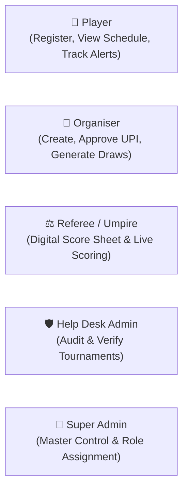
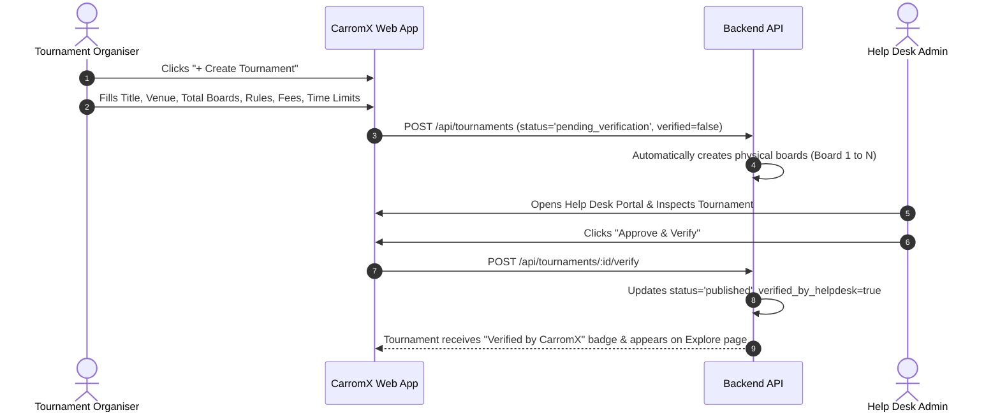
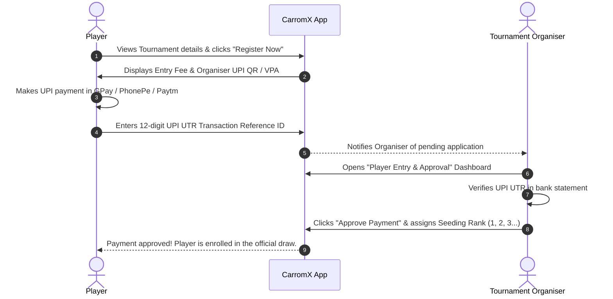
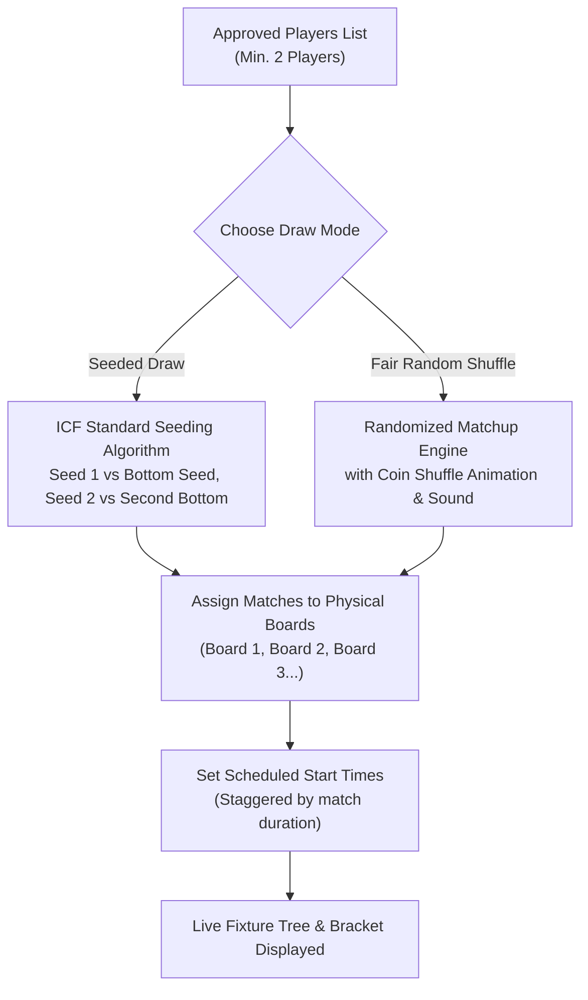
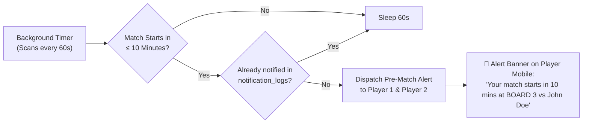
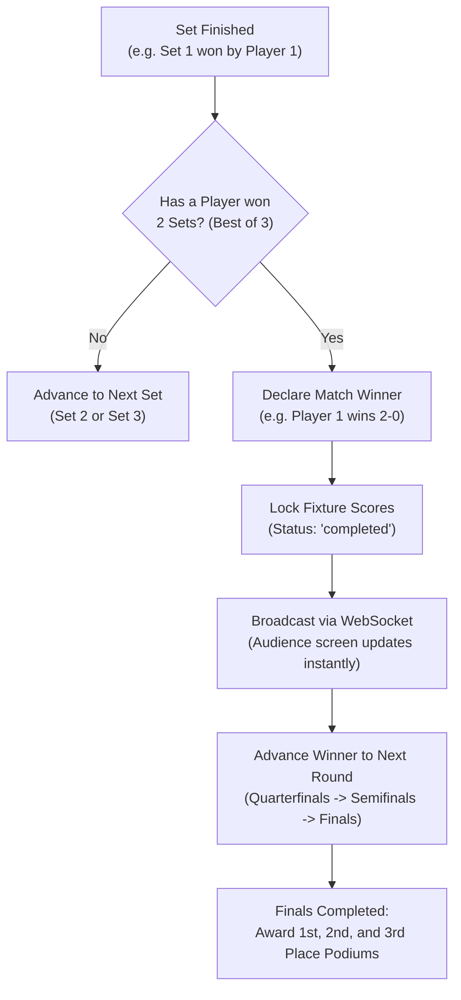

# CarromX: Complete Functionality Guide & User Operations Manual

**Application:** CarromX – Local Carrom Tournament Management Platform  
**Target Audience:** Tournament Organisers, Players, Referees/Umpires, Help Desk Admins, and Super Administrators  
**Document Type:** Complete Functional Specification & "How It Works" Guide  
**Release:** October 2026 Production Edition  

---

## 1. What is CarromX & Why Does It Exist?

Carrom tournaments in India and worldwide have traditionally been run using handwritten chart papers, physical score sheets, manual coin calculations, and word-of-mouth announcements. This leads to common tournament bottlenecks:
- **Scheduling Delays:** Players wandering away from the venue and missing their turns.
- **Scoring Disputes:** Disagreements over queen cover points, penalty dues, or board tallies.
- **Payment Bottlenecks:** Organisers struggling to track manual UPI payments and verify bank UTRs.
- **Lack of Transparency:** Spectators and distant family members unable to see live match scores.

**CarromX** digitizes and streamlines the entire carrom tournament lifecycle into a single web and mobile platform, while adhering strictly to **All India Carrom Federation (AICF)** and **International Carrom Federation (ICF)** tournament standards.

---

## 2. The 5 User Roles: Who Does What?

CarromX features 5 user roles. To prevent accidental role tampering, **roles are controlled exclusively by the Administrator**.



### 1. 🎯 Player
- Explores upcoming and live carrom tournaments in their city.
- Registers for tournaments with one click and submits UPI payment references.
- Views their personal **"My Schedule"** card showing upcoming matches, assigned board number, and countdown timer.
- Receives automated **10-Minute Pre-Match Alerts** so they never forfeit a game.
- Follows live matches, set scores, and knockout bracket trees in real-time.

### 2. 📂 Tournament Organiser
- Creates tournaments defining physical board counts, set time limits, match durations, and rules.
- Manages player entries: reviews UPI transaction UTRs, approves/rejects payments, and assigns seeding ranks.
- Generates tournament brackets using either **Seeded Draw** or **Fair Random Shuffle** with animated coin reveals.
- Dynamically assigns matches to physical venue boards (Board 1, Board 2, etc.).
- Performs **Player Swaps** or **Manual Schedule Overrides** if a player is delayed.
- Appoints Referees/Umpires and assigns them to specific boards.

### 3. ⚖️ Referee / Umpire
- Officiates live matches directly on mobile or tablet at courtside.
- Fills the official **AICF Digital Score Sheet** board-by-board (+1 White, +1 Black, +3 Queen, -1 Due/Penalty).
- Enforces time limits (25-minute set timer & 45-minute match clock).
- Records toss results (toss winner and choice of White/Black/Side).
- Locks completed sets to prevent accidental alterations.
- Captures digital signatures and exports print-ready official PDF score sheets.

### 4. 🛡️ Help Desk Admin
- Acts as the quality assurance and trust layer of CarromX.
- Audits newly created tournaments to confirm venue authenticity, fair entry fees, and valid rules.
- Awards the official **"Verified by CarromX"** trust badge so players can safely register and pay.
- Mediates scoring disputes or complaints raised by participants.

### 5. 👑 Super Admin (Master Account)
- Primary Administrator credentials: Email `carrromx@gmail.com`, Phone `+919600436921`, Password `Ramanan@03`.
- Master User Directory: Can view all registered users and assign/change roles.
- Universal Override: Can edit, unlock, or re-verify any tournament, match, or score across the entire platform.
- Imposter Phone Protection: Pinned to `+919600436921`; non-admin users are blocked from claiming the admin mobile number.

---

## 3. Core Feature Walkthrough: How It Works Step-by-Step

---

### Step 1: Tournament Creation & Help Desk Verification



#### What Information is Configured?
- **Tournament Title & Venue:** Name and complete physical address of the stadium or club.
- **Tournament Format:**
  - *Knockout (Single Elimination):* Standard tournament format where losers exit and winners advance.
  - *Round Robin / League:* Each player plays all others in their pool.
  - *Double Elimination:* Players get a second chance in the losers' bracket.
- **Physical Board Count:** How many carrom boards are physically set up at the venue (e.g., 4 boards, 8 boards, 16 boards).
- **Match Timers & Rules:**
  - *Set Time Limit:* Standard 25 minutes per set (or custom).
  - *Match Duration:* Standard 45 minutes total match time.
  - *Max Points Per Set:* 25 points (standard ICF).
  - *Boards Per Set:* 8 boards cap per set.
  - *Total Sets:* Best of 3 sets (first to win 2 sets wins the match).
- **Entry Fee & Organizer UPI ID:** Organiser's GPay/PhonePe/Paytm UPI ID (e.g. `9600436921@paytm`) for direct payment collection.

> [!NOTE]
> **Safety Guard:** Player accounts attempting to create a tournament are stopped by a friendly modal explaining that only registered **Organisers** or **Admins** have hosting privileges, with instructions to contact the administrator.

---

### Step 2: Player Registration & Payment Approval



- **Direct Payment Model:** 100% of the tournament entry fee goes directly to the Organiser's personal UPI. CarromX does not hold user funds.
- **Proof Verification:** Players enter their 12-digit bank reference (UTR). Organisers verify this in their UPI app before clicking "Approve".
- **Seeding Ranks:** Organisers can assign seeding ranks (e.g. Seed 1 for State Champion, Seed 2 for Runner Up) to ensure top players don't meet in Round 1.

---

### Step 3: Automated Fixture Engine & Bracket Generation

Once players are approved, the Organiser generates the match schedule with one click:



#### Key Capabilities of the Fixture Engine:
1. **Byes Handling:** If the player count is not a power of 2 (e.g. 10 players in a 16-player bracket), the algorithm automatically awards Byes to the top-seeded players.
2. **Board Allocation:** Matches are distributed evenly across active boards (`is_active = true`).
3. **Manual Swap & Interchanges:** If Player A's train is delayed, the Organiser can click "Swap Match" or "Reassign Board" to move another scheduled pair onto the open board immediately, preventing venue downtime.

---

### Step 4: 10-Minute Pre-Match Automated Notification Engine

One of the biggest problems in carrom tournaments is players wandering off to canteen areas and missing their matches. CarromX solves this autonomously:



- **Zero Manual Work:** Organisers don't have to shout on microphones or run around searching for players.
- **Precise Guidance:** The alert provides the exact board number, opponent name, scheduled start time, and set time limit.

---

### Step 5: Official AICF / ICF Digital Score Sheet

At courtside, the assigned Referee or Umpire opens the match fixture and clicks **"Open Score Sheet"**.

```
┌─────────────────────────────────────────────────────────────────────────────┐
│                       OFFICIAL CARROM SCORE SHEET                           │
│  Match No: M-04    Pool: Group A    Age Group: Men's Open    Type: Singles  │
│  Umpire: K. Ramanan       Chief Referee: S. Suresh       Board No: Board 2 │
├─────────────────────────────────────────────────────────────────────────────┤
│  TOSS: Won by [Player 1]  │ Choice: [White Side]  │ Game 1 Start: 10:15 AM │
├────┬──────────┬──────────┬──────────┬───────┬─────────┬────────┬───────┬────┤
│Brd │ Break By │ P1 Coins │ P2 Coins │ Queen │ Due/Pen │ Winner │ Score │Cum.│
├────┼──────────┼──────────┼──────────┼───────┼─────────┼────────┼───────┼────┤
│ 1  │ Player 1 │    6     │    3     │  P1   │    0    │   P1   │   9   │9-0 │
│ 2  │ Player 2 │    4     │    5     │  P2   │    0    │   P2   │   8   │9-8 │
│ 3  │ Player 1 │    7     │    2     │   -   │   -1    │   P1   │   6   │15-8│
│... │   ...    │   ...    │   ...    │  ...  │   ...   │  ...   │  ...  │... │
├────┴──────────┴──────────┴──────────┴───────┴─────────┴────────┴───────┴────┤
│  SET 1 FINAL: Player 1 (25) vs Player 2 (14) -> Winner: Player 1           │
│  Signatures: [✓ Umpire]   [✓ Chief Referee]   [✓ Player 1]   [✓ Player 2]   │
└─────────────────────────────────────────────────────────────────────────────┘
```

#### Built-in AICF Tournament Rules Enforced by the System:
1. **White Carrom Men (+1 pt) & Black Carrom Men (+1 pt)**: Points awarded for every opponent coin remaining on the board when the winner finishes.
2. **Queen (+3 pts)**: If the player who finished also pocketed and covered the red Queen, they receive +3 bonus points.
3. **Queen Score Cap (21 Points Rule)**: Under international ICF rules, once a player's cumulative score reaches **21 points or higher**, no Queen points are awarded. The software enforces this automatically.
4. **Due / Penalty Deductions (-1 pt)**: Pocketing the striker, wrong coin pocketing, or technical fouls automatically register penalty dues.
5. **Set Time Limits**: If the 25-minute set timer runs out before 25 points or 8 boards are completed, the player leading at that moment is automatically declared set winner.
6. **Digital Signatures & PDF Export**: Both players and officials review the board tallies, tap to sign, and can export an official PDF matching federation paper sheets.

---

### Step 6: Set Completion & Bracket Advancement



---

## 4. Real-Time Synchronization: How Spectators Watch

CarromX features a WebSocket gateway:
- **No Refresh Required:** Spectators, family members, or players waiting in seating areas keep the CarromX website or mobile app open.
- When an umpire logs a coin or set win on Board 2, the WebSocket gateway broadcasts `SCORE_UPDATE` within **200 milliseconds**.
- Every connected phone, laptop, or projector at the venue updates smoothly in real time.

---

## 5. Security Architecture & Role Enforcement

| Security Area | How It Works in CarromX |
| :--- | :--- |
| **Player / Organiser Login** | 6-digit OTP dispatched to user email/SMS. Temporary token valid for session. No password needed for public users. |
| **Super Admin Login** | Triple-locked: Email (`carrromx@gmail.com`) + Phone (`+919600436921`) + Password (`Ramanan@03`). Protected against brute force. |
| **Imposter Prevention** | Non-admin accounts attempting to register with `+919600436921` are rejected with `403 Forbidden`. The Super Admin mobile is permanently reserved. |
| **Role Elevation Lockdown** | Players cannot edit their own role. There is no dropdown to self-promote to Organiser. Only Super Admin can change user roles in the Directory. |
| **Session Integrity** | Unauthenticated visitors remain strictly logged out (no silent demo auto-logins). Token expirations are handled gracefully. |

---

## 6. Frequently Asked Questions (FAQ)

### Q1: What happens if a player does not show up on time?
**Answer:** The Organiser opens the Fixtures tab, clicks **"Swap / Reassign Match"**, and selects an available pair of players to take the board immediately. The delayed match is pushed to a later time slot without breaking the tournament bracket.

### Q2: Can a player create a tournament?
**Answer:** No. Standard public accounts register as **Players**. If a player clicks "Create Tournament", CarromX displays an informative modal stating that tournament hosting is reserved for registered Organisers and Admins, directing them to contact `carrromx@gmail.com`.

### Q3: What happens if an umpire enters the wrong score by accident?
**Answer:** While finalized sets are locked to prevent accidental court edits, the **Tournament Organiser** or **Super Admin** has an **"Organizer Override"** feature on `/api/fixtures/:id/organizer-override` allowing them to adjust coins, unlock the set, or correct the winner with an audit note.

### Q4: Does the app work if internet connectivity is intermittent?
**Answer:** Yes. The digital score sheet maintains local board states in browser memory, and the mobile app buffers events until the connection is re-established.

---

## 7. Quick Reference: Master Credentials

For system verification, demonstration, and emergency administration:

- **Portal URL:** `http://localhost:3000` (or `https://carromx.onrender.com`)
- **Super Admin Email:** `carrromx@gmail.com`
- **Super Admin Phone:** `+919600436921` (`9600436921`)
- **Super Admin Master Password:** `Ramanan@03`
- **Help Desk Contact:** `carrromx@gmail.com`
